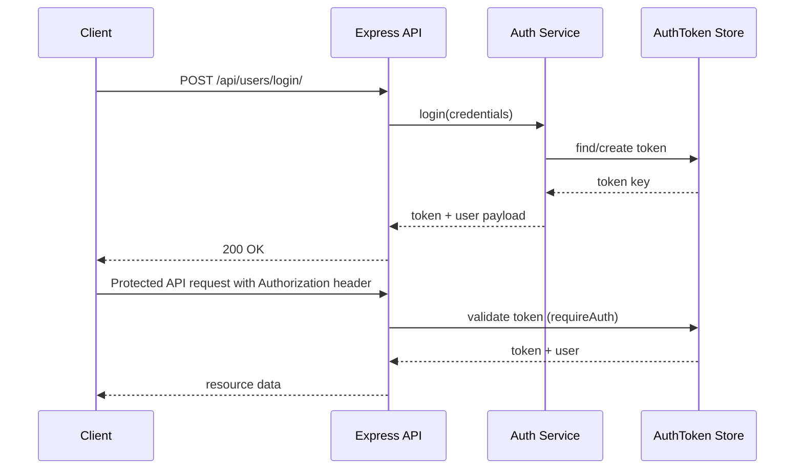
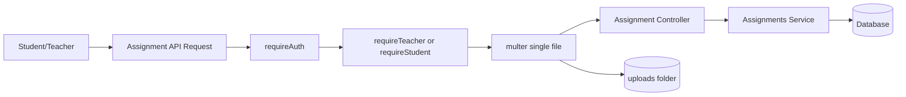

# Backend Architecture Diagram

## System Architecture (Mermaid)

```mermaid
flowchart TD
  C[Client: Web/Mobile] -->|HTTP Request| A[Express App]

  A --> M1[Helmet/CORS/Morgan]
  A --> M2[JSON + URL Encoded Parser]
  A --> M3[Static Upload Serving]

  A --> R1[/api/users]
  A --> R2[/api/assignments]
  A --> R3[/api/notices]
  A --> R4[/api/quizzes]

  R1 --> AU[requireAuth?]
  R2 --> AA[requireAuth + role guards + multer]
  R3 --> AN[requireAuth + requireTeacher]
  R4 --> AQ[requireAuth + role guards]

  AU --> CU[User Controllers]
  AA --> CA[Assignment Controllers]
  AN --> CN[Notice Controllers]
  AQ --> CQ[Quiz Controllers]

  CU --> SU[Auth Service]
  CA --> SA[Assignments Service]
  CN --> SN[Notices Service]
  CQ --> SQ[Quizzes Service]

  SU --> ORM[TypeORM Repositories]
  SA --> ORM
  SN --> ORM
  SQ --> ORM

  ORM --> DB[(Database)]

  A --> EH[Error Handler + Not Found]
  EH --> C
```

## Authentication Flow



## Assignments Upload Flow



## Module Responsibility Snapshot
- User module: login/register/profile/password/token lifecycle
- Assignment module: assignment publish + submission upload
- Notice module: notice creation/listing
- Quiz module: quiz/attempt/question/option/answer workflow
- Middleware: auth, role check, error control

## PDF Notes
Is file ko Markdown preview me open karke print karoge to diagram + explanation ek structured architecture PDF ban jayega.
